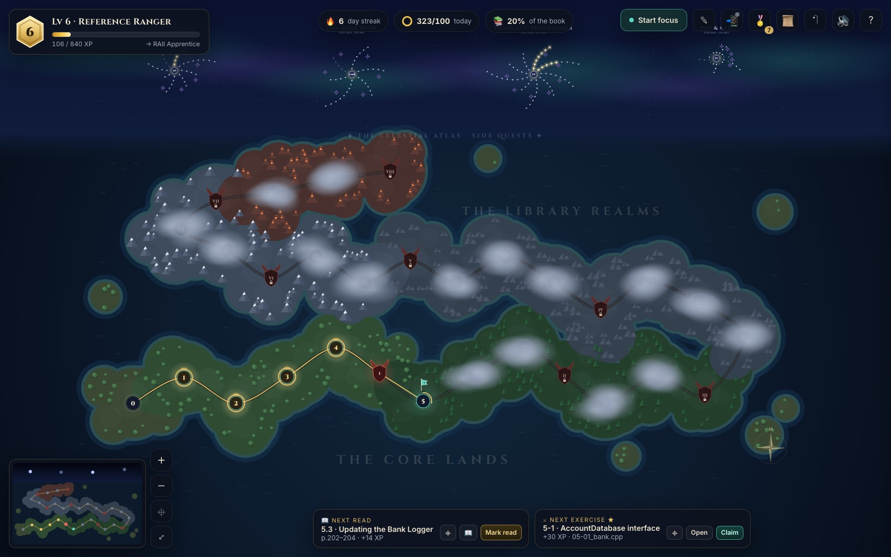
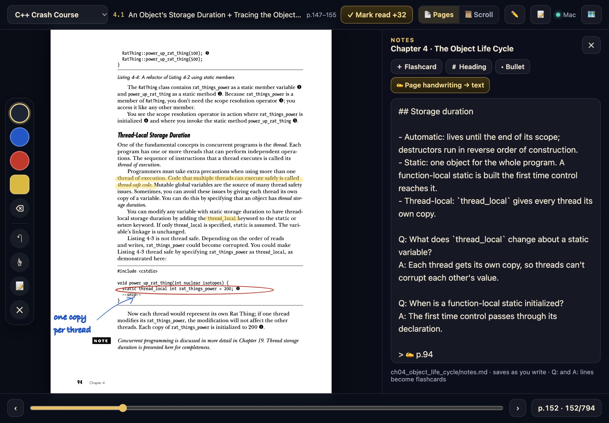
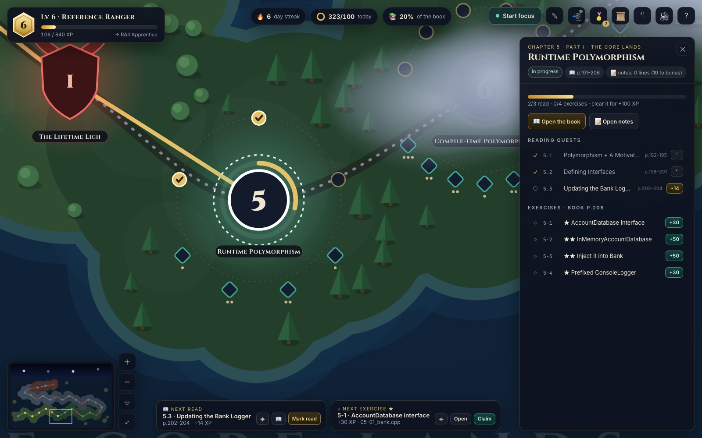
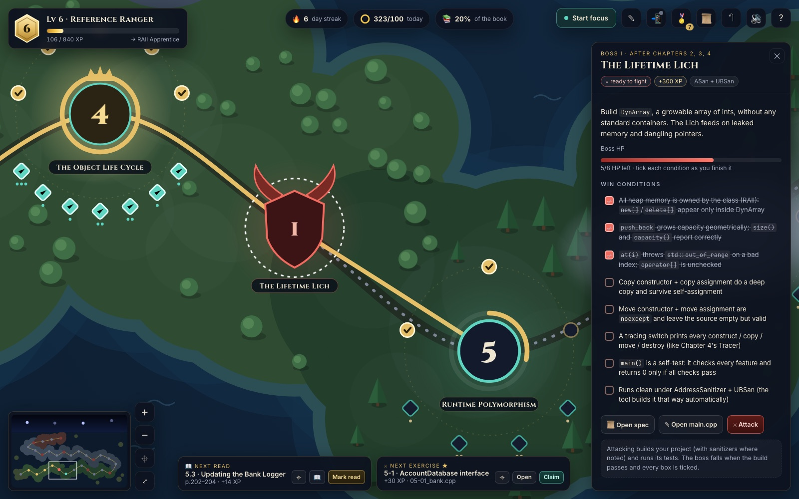
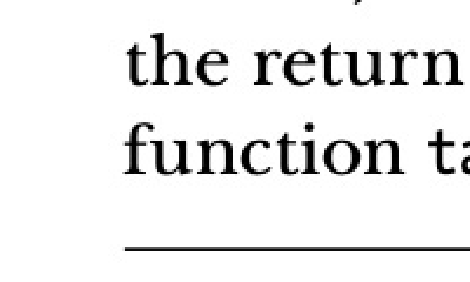
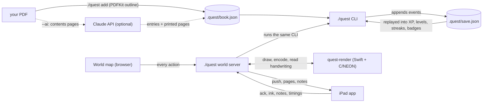

<div align="center">

# ⚔️ Book Quest

**Turn any book into a game you play while you read it.**

<a href="https://github.com/Arihant-Kumar-Jain/book-quest/actions/workflows/tests.yml"></a>




</div>

Put a PDF in the folder and run `./quest add book.pdf`. Book Quest reads the table of contents and builds a
game out of the book: chapters become regions on a map, sections become 4–10 page reading quests, and
checkpoint bosses guard the way. Reading earns XP, streaks and badges. The map runs in your browser, and an
iPad app shows the book with pages drawn natively by your Mac, Apple Pencil notes, and a live link: click
**Open the book** on the Mac and the iPad turns to that page.

I built it to get through a 794-page C++ book without stalling halfway, then made it work for any book.



<sub>The iPad app: Pencil ink on the page, the tools on the left, the chapter's notes beside it.</sub>

## Contents

[Quick start](#-quick-start) · [What you get](#-what-you-get) · [The iPad app](#-the-ipad-app) ·
[Performance](#-performance) · [Security](#-security) · [Tests](#-tests) · [How it works](#-how-it-works) ·
[Configuration](#-configuration) · [Limits](#-limits)

## 🚀 Quick start

Requirements: Python 3.8+ and, on a Mac, the Xcode command line tools (`xcode-select --install`), which
provide `swiftc` for the native page renderer.

```bash
git clone https://github.com/Arihant-Kumar-Jain/book-quest.git
cd book-quest
cp ~/Downloads/"Your Book.pdf" .        # any PDF you own; *.pdf is git-ignored
./quest add "Your Book.pdf"             # builds chapters, quests and bosses from the table of contents
./quest world --ipad                    # the map in your browser, plus the iPad app (scan the QR code)
```

Day to day: `./quest` shows where you are and what's next; `./quest start`, read, `./quest read`,
`./quest stop "what clicked"`. `./quest help` lists everything.

### How a book becomes a map

`./quest add` reads the PDF's bookmarks, whatever they're called ("Chapter", "Lesson", "Kapitel"…). Parts are
recognised by name or by chapter numbers that keep counting across them, and an outline wrapped in a single
book-title entry is unwrapped. Without bookmarks it looks for chapter headings in the page text, and failing
that splits the book into slices you can rename. `--dry-run` shows the result without saving it.

For scanned books, PDFs without bookmarks, or anything it gets wrong, **`--ai`** has Claude read the printed
contents pages instead. This is optional and off by default:

```bash
pip install anthropic                   # and pypdf, on Linux and Windows
export ANTHROPIC_API_KEY=…              # from console.anthropic.com
./quest add "Your Book.pdf" --ai --dry-run
```

It sends the first 40 pages (`--ai-pages N`) to the Claude API (Claude Opus 5.5; `--model` to change) and gets
back each contents entry with its kind and printed page number, constrained to a JSON schema. Everything else
is local: printed numbers are matched to PDF pages through the PDF's page labels or, when it has none, by
finding the page each title opens (a title near the top of a page but not of the two before it, which skips
running heads). `--offset N` sets the shift by hand. The answer is cached in `.quest/.cache/ai`, so running
again after `--dry-run` sends nothing.

## ✨ What you get

| | |
|---|---|
| **Any PDF, one command** | `./quest add` reads the outline with PDFKit (or finds chapter openings in the page text when there is none) and builds chapters, reading quests, Parts, optional front matter and appendices. |
| **A daily loop** | Level, streak with freezes, daily goal, focus timer, flashcards from your notes (`Q:`/`A:` lines), a journal and a generated progress page. |
| **Boss fights** | Checkpoint bosses (*The Forgetting Fog*, *The Skimming Shade*, *The Final Exam Titan*…) with study-habit win conditions. Programming books can have project bosses that only fall when the code builds and passes its tests. |
| **World map** | A pan-and-zoom map laid out from the book: a road through every chapter, regions named after its Parts, side books as constellations. Every button runs the same CLI on the same save. |
| **iPad app** | Pages and scroll modes, Apple Pencil ink, chapter notes with handwriting to text, and a live link to the Mac. Installs from the QR code as a home-screen app. |
| **Side books** | Add more PDFs as optional side quests; they earn XP and never block the main book. |
| **Code exercises** | For programming books: exercises are compile-checked (C, C++, Python, JavaScript, or your own command), with a bonus for warning-free builds. |

<table>
  <tr>
    <td width="50%"></td>
    <td width="50%"></td>
  </tr>
  <tr>
    <td align="center"><sub>A chapter: gold circles are reading quests, teal diamonds are exercises</sub></td>
    <td align="center"><sub>A boss's HP is its unticked win conditions</sub></td>
  </tr>
</table>

## 📲 The iPad app

1. Run `./quest world --ipad`, click **📲** on the Mac's map and scan the QR code with the iPad.
2. In Safari, **Share → Add to Home Screen**. Quest Reader gets its own icon and opens full screen.
3. Click **Open the book** on any quest on the Mac: the iPad turns to that page.

**Reading.** 📄 Pages turns page by page (swipe or tap the edges); 📜 Scroll is one continuous column.
Pinch to zoom and the page is redrawn at twice the resolution. The top bar shows the reading quest you're
in, with **Mark read**.

**Apple Pencil.** Write anywhere on a page; the tools appear on the left the first time the Pencil touches
(three pens, highlighter, eraser, undo). Width follows pressure and tilt, every Pencil sample is used
(`getCoalescedEvents`), the line is drawn ahead of the nib where Safari predicts it (`getPredictedEvents`),
fingers keep turning pages, and a resting palm is ignored. With a Pencil that supports hover, a dot shows
where the nib will land. Ink is stored per page in page-relative coordinates, so it lines up at any size,
orientation or zoom, and it is saved on the Mac.

**Notes.** 📝 opens the chapter's `notes.md` beside the page (below it in portrait). It saves as you type
and counts toward the notes bonus. iPadOS Scribble turns Pencil handwriting into text right in the panel,
and **✍️ Page handwriting → text** reads what you wrote on the page with Apple's Vision framework, on the
Mac (about 0.4 s a page; the first one takes about 1.4 s while Vision loads). If the same notes were edited
on the Mac meanwhile, the two versions are merged, not overwritten.

Safari doesn't expose the Pencil Pro's squeeze, double tap or barrel roll to web pages, so the tools are
on-screen buttons.

## ⚡ Performance

The reader is built like a low-latency system rather than a web page: pages are drawn natively on the Mac,
encoded by a PNG encoder written for book pages, kept in a three-tier cache, and pushed to the iPad before it
asks. Numbers from `./quest bench` on a fanless **MacBook Air (M3, 8 cores, 16 GB)** with a 794-page book,
pages sized for an 11" iPad (1608×2328 px). Full results: [`bench/RESULTS.md`](bench/RESULTS.md).

**On the iPad** (an 11-inch iPad Air over Wi-Fi, from the app's own telemetry):

| | samples | p50 | p95 |
|---|---:|---:|---:|
| Page turn: swipe → new page on screen | 66 | **16 ms** | 32 ms |
| Click **Open the book** on the Mac → preview on the iPad's screen | 3 | 43 ms | 52 ms |
| Click **Open the book** on the Mac → sharp page on the iPad's screen | 4 | 48 ms | 54 ms |
| Jump to any page (slider, link, other book) | 16 | 56 ms | 142 ms |
| Scroll mode: page appears | 277 | 20 ms | 112 ms |
| Fetch a page over Wi-Fi | 312 | 26 ms | 163 ms |
| Decode a page image | 121 | 9 ms | 23 ms |

At the median a page turn takes one frame of the iPad Air's 60 Hz screen. The push rows have few samples so far;
`./quest bench` adds every new sample the next time it runs.

**On the Mac** (server and encoder; the reader is simulated over loopback, so Wi-Fi isn't included):

| | p50 | p95 | p99 |
|---|---:|---:|---:|
| Page from memory | 0.24 ms | 0.29 ms | 0.36 ms |
| Page from disk, right after a restart | 0.61 ms | 1.92 ms | 3.34 ms |
| Page never drawn before (draw, encode, send) | 9.17 ms | 12.59 ms | 21.83 ms |
| Push: click → reader receives it | 1.04 ms | 1.34 ms | 1.56 ms |
| Push: click → sharp page delivered (drawn ahead) | 2.00 ms | 2.59 ms | 3.20 ms |
| Push: click → sharp page delivered (never drawn) | 10.30 ms | 18.85 ms | 27.92 ms |

- **Whole book in the background:** all 794 pages drawn, encoded and cached on disk in 11.7 s on one core (68 pages/s, 94 MB).
- **Throughput:** 3,102 page requests/s (324 MB/s) from 8 concurrent clients over loopback.
- **Correctness:** every encoded page is decoded again with ImageIO and compared pixel by pixel with the
  reference quantizer: **0 mismatches in 491,816,448 pixels**.

### A PNG encoder for book pages

<table>
  <tr>
    <td width="50%"></td>
    <td width="50%"></td>
  </tr>
  <tr>
    <td align="center"><sub>JPEG q0.8 · 436 KB for the page · 4× zoom</sub></td>
    <td align="center"><sub>16-shade PNG · 106 KB for the page · 4× zoom</sub></td>
  </tr>
</table>

Book pages are dark text on white. Sixteen gray levels look the same as 256 for anti-aliased text, and at
4 bits per pixel a PNG is a quarter the size of a JPEG with none of its ringing. Apple's encoders can't write
4-bit grayscale, so [`render.swift`](.quest/render.swift) and [`render_fast.h`](.quest/render_fast.h) write it:

| Stage | How | p50 |
|---|---|---:|
| Draw | PDFKit into an 8-bit bitmap; on a page's first draw, one NEON pass also checks it for color | 2.00 ms |
| Quantize + pack | `(v·15 + 135) >> 8` in NEON (`vld2q`, `vmlal`, `vshrn`), two pixels per byte, rows split over 8 cores. Scalar C: 1.88 ms | **0.11 ms** |
| Deflate | 8 strips compressed in parallel and joined with sync flushes under one Adler-32, the trick [pigz](https://zlib.net/pigz/) uses. One core: 7.76 ms | **1.60 ms** |
| PNG total | Header, CRCs, IDAT. Scalar on one core: 9.98 ms | **1.92 ms** |
| Whole page, first time | Draw → PNG ready to send | 5.43 ms |

Pages with color stay JPEG and photo-heavy gray pages become gray JPEGs; the rest get the 4-bit PNG.

| Encoder, same pages | Size p50 | Encode p50 |
|---|---:|---:|
| **16-shade PNG (this encoder)** | **121 KB** | **1.92 ms** |
| JPEG q0.8 (ImageIO) | 487 KB | 13.24 ms |
| JPEG q0.8, grayscale (ImageIO) | 471 KB | 9.04 ms |
| HEIC q0.6 (ImageIO) | 210 KB | 41.85 ms |
| PNG, 8-bit gray (ImageIO) | 207 KB | 37.57 ms |

### Caching, scheduling and the push

- **Three cache tiers:** memory LRU (384 MB) → disk (1 GB, least-recently-used screen sizes evicted first) →
  render. Concurrent requests for the same page share one render (single-flight futures).
- **Four warm helper processes**, each with the PDF open. A page someone is waiting for uses 8 cores; background
  work uses 1, and two helpers always stay free. Queued look-ahead for pages you've left is dropped
  (generation counter). Once the iPad connects, a background filler draws the whole book, nearest pages first.
- **Push before the click.** Hovering **Open the book** (or selecting a quest) on the Mac draws that page and a
  quarter-size preview for the iPad's exact screen, and sends the iPad a hint so it fetches and decodes the page
  ahead. For 2.5 s afterwards the server sends 30 ms keep-alives, so the iPad's Wi-Fi radio isn't asleep when
  the click arrives. The click is pushed over a Server-Sent Events stream with the preview inlined; the iPad
  acknowledges it.
- **On the iPad:** the neighbouring pages are fetched and decoded in advance, so a turn is a DOM swap; previews
  are only requested while sharp pages are slow to arrive; dragging the slider prefetches the page under your
  thumb.
- Smaller things: `TCP_NODELAY`, HTTP keep-alive, a 0.5 ms GIL switch interval, gzip level 1 for JSON.

The app measures itself: turns, jumps, pushes, fetches and decodes, timed to the frame that's actually
displayed. Tap **Mac** in its top bar for a live overlay; the samples are sent to the Mac and appear in
`./quest bench` next to the Mac's numbers.

## 🔒 Security

The server runs on your machine. With `--ipad` it also listens on your local network, so it is written for that:

| Risk | What stops it |
|---|---|
| Another device on the network | Pairing: a random key in the QR code (kept in `.quest/pair.key`, git-ignored, mode 600) becomes an `HttpOnly`, `SameSite=Strict` cookie. Without it every request gets 403. Delete the file to revoke all devices. |
| A website you visit driving the server (CSRF) | Every write needs a per-run token embedded in the page, compared in constant time, and a matching `Origin`. |
| A website pointing its domain at your Mac (DNS rebinding) | Requests are only answered when the `Host` header is an IP address, `localhost` or a `.local` name. |
| Clickjacking, MIME sniffing, referrer leaks | `X-Frame-Options: DENY`, `X-Content-Type-Options: nosniff`, `Referrer-Policy: no-referrer`, `Cross-Origin-Resource-Policy: same-origin`. |
| Oversized or malformed input | Bodies over 32 MB are refused unread; ink strokes, page numbers and book keys are validated; at most 16 live connections. |
| Running arbitrary commands | The map can only run an allow-list of `./quest` subcommands with validated arguments; opening files in your editor and showing the QR code are Mac-only. |
| Your books and notes | `*.pdf` and your ink are git-ignored. Nothing is uploaded unless you run `./quest add --ai`, which sends the book's first pages to the Claude API and says so as it does; the API key is read by the Anthropic SDK from your environment and never stored. The iPad app on a Mac loads nothing from the internet. |
| A changed file on a CDN | The map's fonts come from Google Fonts and its QR code library from cdnjs; the PDF.js fallback also comes from cdnjs. Each script is pinned to a version and a `sha384` [Subresource Integrity](https://developer.mozilla.org/docs/Web/Security/Subresource_Integrity) hash, so a modified file is refused before it runs, and a test fails if a hash goes missing. |

Traffic on your network is plain HTTP; use a network you trust (a phone hotspot works when campus Wi-Fi
blocks devices from seeing each other).

## 🧪 Tests

```bash
python3 -m unittest discover -s tests -v
```

41 tests. The unit tests cover the importer's rules (titles, parts named in five languages or found by chapter
numbers, single-root outlines, front matter, appendices, quest sizes, bosses), the `--ai` request and its strict
schema, page placement through labels and through page text with running heads, stroke validation, the quantizer
constant and the integrity hashes on CDN scripts. The end-to-end tests write a PDF with a table of contents,
import it with `./quest add` (and with `--ai`, against a stand-in for the SDK that logs the request), start the
real server and check that pages come back as valid 4-bit PNGs (parsed by hand: chunk CRCs, inflated size), that
ink and notes round-trip (including a stale-write conflict), and that the security rules above hold. CI runs
them on macOS and Linux on every push.

`./quest bench` measures everything in [Performance](#-performance) and writes `bench/RESULTS.md`.

## 🏗️ How it works



- **Event-sourced save.** `save.json` is an append-only list of events ("read 2.3", "done 2-1 clean"). XP,
  levels, streaks and badges are recomputed from it on every run, so `./quest undo` is always safe.
- **One rules engine.** The map and the iPad never edit the save: the server runs the same `./quest`
  commands the terminal does.
- **No dependencies.** The CLI and server are one Python file using only the standard library; the pages are
  plain HTML, SVG and JavaScript. On a Mac, `.quest/render.swift` and `.quest/render_fast.h` are compiled once
  with `swiftc -O` into `.quest/.bin/quest-render`, which links only Apple frameworks and the system zlib. The
  optional `--ai` import is the one feature that needs a package (`anthropic`), imported only when you use it.

## 🛠️ Configuration

Everything `./quest add` decides lands in `.quest/book.json`; edit it freely and run `./quest init` to create
any new folders.

| Key | What it does |
|---|---|
| `title`, `short`, `author` | The book's name; `short` appears in headers and on the map. |
| `pdf` / `pdf_match` | Where the PDF is, or text its filename contains. |
| `chapters[]` | `num`, `title`, `part`, `optional`, `dir`, `reading[]` (quests: `id`, `title`, `pdf`/`end` PDF pages, `page`/`page_end` printed pages, `xp`) and `exercises[]`. |
| `parts`, `part_xp` | Names for each part number, and the XP for clearing it (default 500). |
| `bosses[]` | `n`, `name`, `unlock` (chapter numbers), `xp`, `pitch`, `goals`, `build` (`none` for checklist bosses). |
| `side[]` | Side books, with their own `key`, `chapters` and optional `labs`. |
| `code` | `cpp`, `c`, `python`, `javascript`, or your own commands, e.g. `{"ext": [".rs"], "build": ["rustc", "{main}", "-o", "{out}"], "run": ["{out}"]}`. |
| `titles` | Your own 20 level titles. |

[`examples/cpp-crash-course`](examples/cpp-crash-course) is the full setup this project grew out of: 98
compile-checked exercises, 8 project bosses built with AddressSanitizer and ThreadSanitizer, 4 side books with
labs, and a Linux dev container.

```
book-quest/
├── quest                  the CLI and the world server (Python 3, standard library only)
├── .quest/
│   ├── render.swift       native helper: PDFKit drawing, outlines, Vision handwriting, the PNG writer
│   ├── render_fast.h      C + ARM NEON hot loops (quantize/pack, gray + color pass, strip deflate)
│   ├── world.html         the world map
│   ├── reader.html        the iPad app
│   └── book.json, save.json, ink/, perf.json, pair.key   your data (the last three git-ignored)
├── tests/                 unit + end-to-end tests
├── bench/                 RESULTS.md from ./quest bench
├── examples/              ready-made configs
└── docs/                  screenshots
```

## 🚧 Limits

- **Linux and Windows** run everything except the PDFKit parts: `./quest add` can't read the outline there (it
  splits the book into equal slices you can rename in `book.json`, or use `--ai` with `pypdf`), and the iPad
  app falls back to PDF.js, which needs internet the first time. On Windows, run `python quest …`.
- **`--ai`** needs a network connection and an Anthropic API key, and the request is billed to that key (the
  command prints the tokens it used). It reads the contents from the first 40 pages; if they run longer, it
  says so and `--ai-pages` sends more.
- **Handwriting recognition** is Vision's; it is good with clear writing and can misread acronyms.
- **Pencil Pro gestures** (squeeze, double tap, barrel roll) need a native app; Safari doesn't expose them.

## 📚 Credits

No books are included; bring your own PDFs. Apple's PDFKit, CoreGraphics, ImageIO and Vision, and zlib, do the
native work; the parallel-deflate idea comes from Mark Adler's [pigz](https://zlib.net/pigz/).
[PDF.js](https://mozilla.github.io/pdf.js/) by Mozilla is the fallback reader,
[qrcode-generator](https://github.com/kazuhikoarase/qrcode-generator) by Kazuhiko Arase draws the pairing code,
and the fonts are Cinzel, Inter and JetBrains Mono from Google Fonts. MIT licensed.
