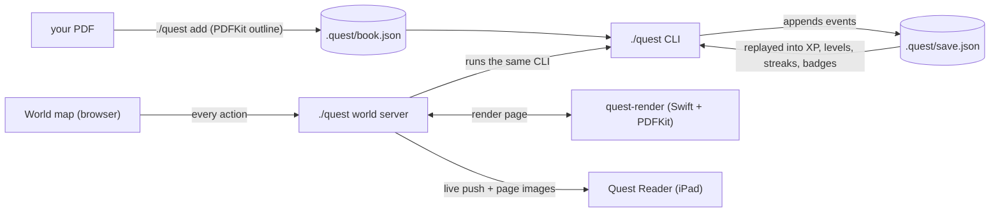

<div align="center">

# ⚔️ Book Quest

**Turn any book into a game you play while you read it.**


<sub>The world map for <i>C++ Crash Course</i>, one of the included examples.</sub>

</div>

Drop a PDF into this folder and run one command. Book Quest reads the book's table of contents and builds a
game around it: chapters become regions on a winding road, sections become short reading quests, and
checkpoint bosses guard the way. Reading earns XP, builds a streak and unlocks badges. A clickable fantasy map
runs in your browser, and an iPad reader shows the book with pages drawn natively by your Mac.

I built this to get through *C++ Crash Course* without stalling halfway, then made it work for any book.

```
  ⚔  THE GNU MAKE BOOK · QUEST LOG
  Lv 2 · Page Turner    339 XP
  ████░░░░░░░░░░░░░░░░░░░░  99/360 to Lv 3 Margin Scribbler
  🔥 Streak 4 days · best 4
  🎯 Today 161/100 XP  ████████████  goal hit! +25
  📚 Book 19%  ██░░░░░░░░░░  · 🏅 3/22 badges · ⏱️ 1h 05m focused

  ▶ Chapter 2 · Makefile Debugging   reading 0/6
  Next up
    📖 2.1  Printing the Value of a Makefile Variable + Dumping Every Makefile Variable  p.43–46  +17
       read it, jot notes in ch02_makefile_debugging/notes.md, then: ./quest read
```

## ✨ What you get

| | |
|---|---|
| 📖 **Any PDF, one command** | `./quest add book.pdf` reads the outline (or finds chapter openings in the text when there is none) and builds chapters, 4–10 page reading quests, optional front matter and appendices, and Parts. |
| 🧭 **A daily loop** | One command shows your level, streak, daily goal and the exact next step. A focus timer, flashcards from your notes, a journal and an auto-generated progress page come with it. |
| 🐉 **Boss fights** | Checkpoint bosses (*The Forgetting Fog*, *The Skimming Shade*, *The Final Exam Titan*…) with study-habit win conditions: summarize from memory, write flashcards, explain it out loud. Or write your own project bosses with build checks. |
| 🗺️ **World map** | `./quest world` opens a pan-and-zoom fantasy map laid out from your book. Every button runs the same CLI on the same save. |
| 📲 **iPad reader** | Pair an iPad by QR code. The Mac draws pages with Apple's PDFKit and pushes them live: **Open the book** on the map turns the iPad's page in milliseconds. Read page by page or scroll. |
| 🌌 **Side quests** | Add more PDFs as optional side books. They become constellations in the sky and earn XP without ever blocking your main quest. |
| 💻 **Code exercises (optional)** | For programming books: exercises are compile-checked (C, C++, Python, JavaScript, or your own command), with a bonus for warning-free builds. |

<table>
  <tr>
    <td width="50%"></td>
    <td width="50%"></td>
  </tr>
  <tr>
    <td align="center"><sub>Zoom into a chapter: gold circles are reading quests, teal diamonds are exercises</sub></td>
    <td align="center"><sub>A boss's HP is its unticked win conditions</sub></td>
  </tr>
  <tr>
    <td colspan="2"></td>
  </tr>
  <tr>
    <td colspan="2" align="center"><sub>Side-quest books are constellations; stars light up as you read (screenshots use a demo save)</sub></td>
  </tr>
</table>

---

## 🚀 Quick start

**Requirements:** Python 3.8+. On a Mac, the Xcode command line tools (`xcode-select --install`) let Book
Quest read PDFs and draw pages with Apple's PDFKit. Linux works too (see [Notes](#-notes)).

```bash
git clone https://github.com/Arihant-Kumar-Jain/book-quest.git
cd book-quest
```

1. **Copy your book's PDF into the folder.** Any PDF you own. PDFs are git-ignored, so they never get committed.
2. **Build your quest:**
   ```bash
   ./quest add "My Book.pdf"
   ```
3. **Play:** `./quest` shows the dashboard, `./quest world` opens the map, and the daily loop is
   `./quest start` → read → `./quest read` → `./quest stop "what clicked"`.

Want a second book alongside it? `./quest add "Another Book.pdf"` adds it as a side quest. Add `--dry-run` to
preview what the importer would build, and `--title "…"` or `--short "…"` to name the book yourself.

## 📖 How a PDF becomes a quest

```
$ ./quest add "The GNU Make Book.pdf"
  ✔ The GNU Make Book
     256 pages · 6 chapters (+1 optional) · 38 reading quests · 2 bosses
       0 Before You Begin (optional)  p.xv–xvi · 1 quests
       1 The Basics Revisited  p.1–42 · 7 quests
       2 Makefile Debugging  p.43–76 · 6 quests
       ...
```

- **Chapters** come from the PDF's outline, or from "Chapter N" pages when the PDF has no outline. Books split
  into *Part I*, *Part II*… keep those parts: each becomes a region on the map, with its own badge.
- **Reading quests** follow the book's sections, merged or split into chunks of about 4–10 pages. Each one is
  worth 5 XP plus 3 per page, and shows the printed page numbers.
- **Front matter** (foreword, preface, introduction) becomes an optional *Before You Begin* chapter.
  Appendices are optional; the cover, contents, index and the like are skipped.
- **Bosses** guard every few chapters (one per part, when the book has parts). They have no code: tick their
  win conditions in `projects/<boss>/README.md` and attack.
- Everything lands in `.quest/book.json`. It's plain JSON, so rename chapters, mark one optional, or add
  exercises whenever you like, then run `./quest init` to create any new folders.

## 🗺️ The world map

```bash
./quest world
```

The map runs on your own machine (`127.0.0.1` only) and uses the same save file as the terminal.

- **Explore:** drag or two-finger swipe to pan, and use the mouse wheel, pinch or ⌘ + scroll to zoom. Chapters
  sit along a road that snakes across the land, bosses are horned lairs, and unexplored chapters stay under fog.
- **Click anything** to open its panel: mark reading done, open your notes, tick a boss's win conditions, or attack.
- **Look up** for the side-quest books: each is a constellation that lights up as you read.
- **Deep links:** `#ch:5`, `#boss:1`, `#world` or `#sky` jump straight there. Press `?` for every shortcut.

## 📲 Read on your iPad

```bash
./quest world --ipad
```

1. Put the Mac and iPad on the same network. If macOS asks whether Python may accept incoming connections,
   click **Allow**.
2. Click **📲** on the Mac's map and scan the QR code with the iPad's camera. Share → **Add to Home Screen**
   turns the reader into a full-screen app.
3. **Open the book** on any quest in the Mac's map now turns the iPad to that exact page, in every book.

Pick **📄 Pages** or **📜 Scroll** in the reader's top bar. Pinch to zoom and the page is redrawn at twice the
resolution. The top bar shows which reading quest you're in, with a **Mark read** button.

**Why it's fast:** the iPad never parses a PDF. The Mac draws each page with Apple's PDFKit (a small Swift helper,
`.quest/render.swift`, built once with `swiftc`) and sends a ready-made image sized to the iPad's screen. The
pages around the one you're on are drawn ahead, so a page turn swaps in an image that's already decoded (under
1 ms) and an unseen page takes about 30 ms on the Mac plus the Wi-Fi transfer. "Open the book" travels over a live
connection the iPad keeps open, and the iPad confirms it, so the Mac's toast tells you it arrived. Nothing is
loaded from the internet.

> [!NOTE]
> Only devices that scanned the code can connect; the key lives in `.quest/pair.key` (git-ignored), and
> deleting it revokes access. Traffic isn't encrypted, so use a network you trust. Campus Wi-Fi often blocks
> devices from talking to each other; a phone hotspot works instead, and the 📲 screen lists every address the
> Mac can be reached on.

## 🐉 Bosses

Imported books get checkpoint bosses whose win conditions are study habits that make reading stick:

```markdown
- [ ] Without looking at the book, write a one-page summary of chapters 1–3 in your notes
- [ ] Write at least 5 flashcards (Q:/A:) on these chapters and get them right in ./quest review
- [ ] Explain the hardest idea from these chapters out loud in 2 minutes
```

Each unticked box is a point of HP. Tick them as you go, then `./quest boss 1` (or **Attack** on the map). For a
programming book you can write project bosses instead: set `"build"` to `plain` (or `sanitize`/`tsan` for C
and C++) and the boss only falls when your code builds and its self-test or `tests/*.in` → `.out` checks pass.

## 💻 Books with code exercises

Add `"code"` to `.quest/book.json` and exercises to any chapter:

```json
"code": "python",
"chapters": [{ "num": 3, "title": "Lists", "exercises": [
  { "id": "3-1", "kind": "code", "stars": 2, "file": "03-01_flatten.py",
    "title": "Flatten a nested list", "task": "Write flatten() without recursion.",
    "optional": false, "bonus": false, "boost": false }
]}]
```

Presets: `cpp`, `c`, `python`, `javascript`. For anything else, give the commands:
`"code": {"ext": [".rs"], "build": ["rustc", "{main}", "-o", "{out}"], "run": ["{out}"]}`.
Then `./quest run 3-1` builds and runs it, and `./quest done 3-1` checks it before awarding XP (plus 10 for a
warning-free build). Exercises of any other `kind` (`reading`, `research`, `lab`) are just claimed with
`./quest done 3-1 "what I learned"`.

## 🧩 Example: C++ Crash Course

[`examples/cpp-crash-course`](examples/cpp-crash-course) is the full setup this project grew out of: 98
compile-checked exercises, 8 project bosses built with AddressSanitizer and ThreadSanitizer, 4 side books with
hands-on labs, custom level titles, and a Linux dev container. Own the book? Copy its `book.json` into `.quest/`,
add the PDF and run `./quest init`.

## 🛠️ book.json reference

| Key | What it does |
|---|---|
| `title`, `short`, `author` | The book's name; `short` is used in headers and on the map. |
| `pdf` / `pdf_match` | Where the PDF is, or text its filename contains. |
| `chapters[]` | `num`, `title`, `part`, `optional`, `dir`, `reading[]` (quests: `id`, `title`, `pdf`/`end` PDF pages, `page`/`page_end` printed pages, `xp`) and `exercises[]`. |
| `parts`, `part_xp` | Names for each part number, and the XP for clearing it (default 500). |
| `bosses[]` | `n`, `name`, `unlock` (chapter numbers), `xp`, `pitch`, `goals`, `build` (`none` for checklist bosses). |
| `side[]` | Side books, with their own `key`, `chapters` and optional `labs`. |
| `code` | Language preset or custom commands for exercises (see above). |
| `titles` | Your own 20 level titles. |

## 🏗️ How it works



- **Event-sourced save.** `save.json` is an append-only list of events ("read 2.3", "done 2-1 clean"). XP,
  levels, streaks and badges are recomputed from it on every run, so `./quest undo` is always safe.
- **One rules engine.** The map and the iPad never change the save themselves: the server runs the same
  `./quest` commands the terminal does.
- **No dependencies.** The CLI and server are one Python file using only the standard library, and the pages
  are plain HTML/SVG/JS. On a Mac, `.quest/render.swift` (about 140 lines) is compiled once into
  `.quest/.bin/quest-render`; it reads outlines and draws pages with PDFKit and encodes them with ImageIO.
- **Live link.** The reader holds a Server-Sent Events stream open; "Open the book" pushes the page down it
  and the reader acknowledges it.
- **Security.** The server listens on `127.0.0.1` unless you pass `--ipad`. Every action needs a per-run token,
  requests from other websites are rejected, and paired devices need the key from the QR code.

## 🗂️ Folder map

After `./quest add`, your folder looks like this:

```
book-quest/
├── quest                   ← the game: CLI + world server (Python 3, standard library only)
├── My Book.pdf             ← your PDF (git-ignored)
├── PROGRESS.md             ← auto-generated scoreboard: map, badges, heatmap, recent activity
├── journal.md              ← study log (sessions, notes, milestones)
├── chNN_<title>/notes.md   ← one folder per chapter; write notes and Q:/A: flashcards here
├── projects/bossN_<name>/  ← each boss's README with its win conditions
├── side_quests/<book>/     ← notes for side books
├── examples/               ← ready-made configs (C++ Crash Course)
└── .quest/                 ← book.json, save.json, world.html, reader.html, render.swift
```

## 📝 Notes

- **Linux:** everything works except the PDFKit parts. `./quest add` can't read the outline there, so it splits
  the book into equal slices you can rename in `book.json` (or import on a Mac and copy `book.json` over).
  The iPad reader falls back to Mozilla's PDF.js, which needs internet the first time.
- **Windows:** run it with `python quest …`; the PDFKit notes for Linux apply.
- **Flashcards:** any `Q:` line followed by an `A:` line in a `notes.md` becomes a card for `./quest review`.
- **Your progress is yours:** commit `save.json`, `journal.md` and your notes to keep a public log of your
  reading, or keep the repo private.

## 💡 How not to quit

- **Shrink the day, keep the streak.** A tired evening's minimum is one reading quest.
- **End every session with `./quest`,** so tomorrow's first step is already on screen.
- **Stuck?** Write the question in your notes and move on. Reading ahead counts, and you can come back.
- **Check `PROGRESS.md` once a week.** The heatmap shows how consistent you've been.

## 📚 Credits

- No books are included; bring your own PDFs.
- Apple's PDFKit and ImageIO for native page rendering, [PDF.js](https://mozilla.github.io/pdf.js/) by Mozilla
  for the fallback reader, [qrcode-generator](https://github.com/kazuhikoarase/qrcode-generator) by Kazuhiko
  Arase, and the Cinzel, Inter and JetBrains Mono fonts from Google Fonts.
- Released under the [MIT license](LICENSE).
